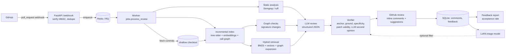

# Architecture

## Design decisions

| Decision | Why | Trade-off |
|---|---|---|
| Index + retrieve instead of stuffing the repo into the prompt | Cost, latency and accuracy degrade with irrelevant context | Retrieval can miss the needed file; measured as *retrieval recall* in the eval |
| Hybrid BM25 + embeddings | Embeddings miss exact identifiers; keywords miss meaning | Two indexes to maintain |
| Graph expansion (callers, callees, tests) | Bugs usually live in the interaction between files | Name-based resolution is approximate in Python |
| Deterministic signature-change check | Cross-file contract breaks should not depend on LLM luck | Only catches signature/removal changes |
| Static findings are *triaged*, not copied | Combines high-recall analyzers with LLM judgement about false positives | Depends on the LLM reading the code correctly |
| Evidence-grounding rule | Cheap, effective hallucination filter | May drop a correct comment whose quote was paraphrased |
| Patch validation (parse + pyflakes delta) | A broken one-click fix destroys trust | Rejects fixes needing new imports |
| Webhook returns fast, work is queued | GitHub expects replies within seconds; LLM calls are slow | Needs Redis in production |
| Delivery-id and (repo, PR, sha) idempotency | GitHub retries; users re-run deliveries | Failed jobs release the claim so retries work |
| Shallow fetch by SHA with token in an HTTP header | Fast, and credentials never appear in URLs or logs | Needs `allowAnySHA1InWant`-style support (GitHub provides it) |
| Pipeline is GitHub-agnostic | The same code serves the live app and the offline eval | Local diffs must mimic GitHub's `patch` format (they do) |

## Interview talking points

* Why a signature-change graph query beats prompting an LLM to "look for breaking changes".
* How you would measure retrieval quality separately from review quality.
* What the failure analysis showed: which comment types get dropped by the verifier and why.
* Cost control: per-file calls, token budget, file cap, verification only on survivors of the cheap checks.
* What you would change to support a second language or a monorepo with 100k files.
